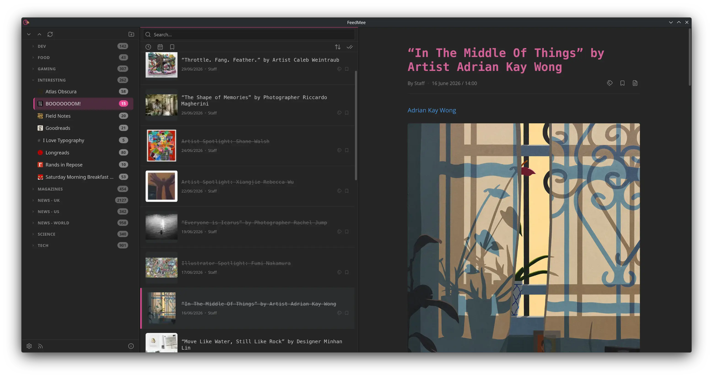

# FeedMee

*FeedMee* is a cross-platform desktop RSS/Atom news reader. Focused on performance and a clean UI.

[Download latest release](https://github.com/dcog989/FeedMee/releases).




## Features

- **Cross-Platform:** Native performance on Windows and Linux (via Tauri v2).
- **Three-Pane Layout:** Classic, responsive interface with keyboard-driven pane navigation.
- **Reader Mode:** Extracts full article content using `dom_smoothie` (Readability), stripping clutter.
- **Feed Management:**
  - Auto-discovery of RSS/Atom links from URLs.
  - Drag-and-drop folder organization.
  - OPML Import/Export.
  - Bluesky profile support via AT Protocol.
- **Smart Views:** "Latest" (24h), "Today", and "Read Later" (Saved) aggregation.
- **Article Tagging:** Color-coded tags for categorization and filtering.
- **Search:** Full-text search across article titles, authors, and summaries.
- **Thumbnails:** Automatic og:image extraction with resizing, WebP caching, and configurable size.
- **Local Privacy:** Feeds, articles, settings and tags stay on your machine. No accounts, no telemetry. Feed icons load from DuckDuckGo's icon service.
- **Auto-Refresh:** Configurable periodic refresh (default 30 min) with 5 concurrent workers and debounce support.
- **Blocked Phrases:** Filter out articles containing unwanted phrases.
- **Article Retention:** Configurable auto-pruning of old articles (default 90 days).
- **Customizable:** Dark/Light/System themes, configurable refresh intervals, thumbnail size, keyboard shortcut remapping, and log rotation.

---

## Install

[Download latest release](https://github.com/dcog989/FeedMee/releases/latest):

| Platform        | Format         | Install                                               |
| --------------- | -------------- | ----------------------------------------------------- |
| Arch / CachyOS  | `.pkg.tar.zst` | `sudo pacman -U feedmee-*.pkg.tar.zst`                |
| Debian / Ubuntu | `.deb`         | `sudo apt install ./FeedMee_*.deb`                    |
| Fedora / RHEL   | `.rpm`         | `sudo dnf install ./FeedMee-*.rpm`                    |
| openSUSE        | `.rpm`         | `sudo zypper install ./FeedMee-*.rpm`                 |
| Linux (any)     | AppImage       | `chmod +x FeedMee_*.AppImage && ./FeedMee_*.AppImage` |
| Windows         | NSIS `.exe`    | Run `FeedMee_*_x64-setup.exe`                         |

Build from source with `just package` (Arch/CachyOS) or `just bundle` (see [Development](#development)).

---

## Technical

### Tech Stack

| Layer                  | Technology                                                                   |
| ---------------------- | ---------------------------------------------------------------------------- |
| **Desktop Framework**  | [Tauri v2](https://v2.tauri.app)                                             |
| **Frontend**           | [Svelte 5](https://svelte.dev) (Runes) + [SvelteKit](https://kit.svelte.dev) |
| **Language**           | TypeScript, Rust                                                             |
| **Database**           | SQLite via `rusqlite`                                                        |
| **HTTP Client**        | `reqwest` (rustls)                                                           |
| **Feed Parsing**       | `feed-rs`                                                                    |
| **Content Extraction** | `dom_smoothie`, `scraper`                                                    |
| **Image Processing**   | `image` + `webp`                                                             |
| **Linting**            | Biome (frontend), Clippy (backend)                                           |
| **Bundling**           | Vite                                                                         |
| **Packaging**          | AppImage, deb, rpm (Linux), NSIS (Windows), makepkg (Arch/CachyOS)           |

### Development


install prerequisites: `bun install`

```sh
just                # Verify the repo: the same checks CI runs.
just build          # Build release binary (no installers)
just check          # Types, lint, and Clippy
just clean          # Remove build artifacts and node_modules
just format         # Biome + rustfmt
just test           # Vitest + cargo test
just dev            # Starts the Vite dev server and Tauri with HMR.
just package        # Build via makepkg (Arch / CachyOS)
just install        # Install the built package (sudo)
```

Dependencies: Bun, Rust (edition 2024, 1.85+).

Linux: WebKitGTK 4.1, GTK 3, librsvg, patchelf. Arch/CachyOS: `webkit2gtk-4.1 gtk3 librsvg patchelf`. Debian/Ubuntu: `libwebkit2gtk-4.1-dev libgtk-3-dev librsvg2-dev patchelf`.

Windows: WebView2 runtime and the MSVC build tools.

Installers (AppImage/deb/rpm/NSIS) are produced by the release workflow or `just bundle`; `just build` stops at the binary.

---

## License

[GNU GPL v3.0 or later](LICENSE).
