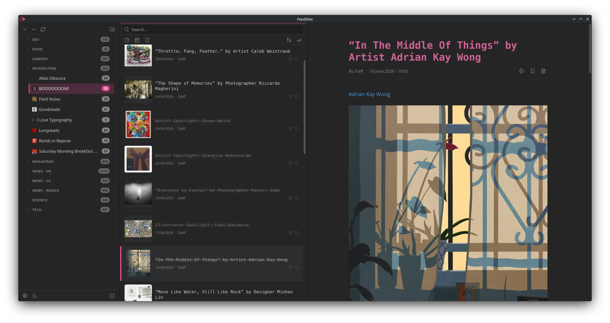

# FeedMee

*FeedMee* is a cross-platform desktop RSS/Atom news reader. Focused on performance and a clean UI.

[Download latest release](https://github.com/dcog989/FeedMee/releases).




## Features

- **Cross-Platform:** Native performance on Windows and Linux (via Tauri v2).
- **Three-Pane Layout:** Classic, responsive interface with keyboard-driven pane navigation.
- **Reader Mode:** Extracts full article content using `dom_smoothie` (Readability), stripping clutter.
- **Feed Management:**
  - Auto-discovery of RSS/Atom links from URLs.
  - Drag-and-drop folder organization.
  - OPML Import/Export.
  - Bluesky profile support via AT Protocol.
- **Smart Views:** "Latest" (24h), "Today", and "Read Later" (Saved) aggregation.
- **Article Tagging:** Color-coded tags for categorization and filtering.
- **Search:** Full-text search across all articles.
- **Thumbnails:** Automatic og:image extraction with resizing, WebP caching, and configurable size.
- **Local Privacy:** All data is stored locally in SQLite. No tracking, no accounts.
- **Auto-Refresh:** Configurable periodic refresh (default 30 min) with 5 concurrent workers and debounce support.
- **Blocked Phrases:** Filter out articles containing unwanted phrases.
- **Article Retention:** Configurable auto-pruning of old articles (default 90 days).
- **Auto-Updater:** Auto-update via GitHub Releases.
- **Customizable:** Dark/Light/System themes, configurable refresh intervals, thumbnail size, keyboard shortcut remapping, and log rotation.

## Keyboard Shortcuts

All letter and punctuation shortcuts are customizable from Settings.

| Key     | Action                     |
| ------- | -------------------------- |
| `/`     | Focus search               |
| `r`     | Refresh all feeds          |
| `n`     | Add new feed               |
| `,`     | Open settings              |
| `s`     | Save/Read later            |
| `m`     | Mark as read/unread        |
| `Enter` | Open article in browser    |
| `x`     | Expand all folders         |
| `c`     | Collapse all folders       |
| `Esc`   | Close modal / Clear search |

Arrow keys move focus between panes (`←`/`→`) and through the article list (`↑`/`↓`); these are fixed and not remappable.

---

## Technical

### Tech Stack

| Layer | Technology |
|---|---|
| **Desktop Framework** | [Tauri v2](https://v2.tauri.app) |
| **Frontend** | [Svelte 5](https://svelte.dev) (Runes) + [SvelteKit](https://kit.svelte.dev) |
| **Language** | TypeScript, Rust |
| **Database** | SQLite via `rusqlite` |
| **HTTP Client** | `reqwest` (rustls) |
| **Feed Parsing** | `feed-rs` |
| **Content Extraction** | `dom_smoothie`, `scraper` |
| **Image Processing** | `image` + `webp` |
| **Linting** | Biome (frontend), Clippy (backend) |
| **Bundling** | Vite |
| **Packaging** | AppImage, deb, rpm (Linux), NSIS (Windows), makepkg (Arch/CachyOS) |

### Development

```sh
bun install         # install prerequisites
bun run build       # Build release binary (no installers)
bun run check       # Types, lint, and Clippy
bun run format      # Biome + rustfmt
bun run test        # Vitest + cargo test
bun run dev         # Starts the Vite dev server and Tauri with HMR.
bun run package     # Build + install via makepkg (Arch / CachyOS)
```

Build / run dependencies: Bun, Rust (edition 2024, 1.85+).

Linux: WebKitGTK 4.1, GTK 3, librsvg, patchelf, OpenSSL headers. Arch/CachyOS: `webkit2gtk-4.1 gtk3 librsvg patchelf openssl`. Debian/Ubuntu: `libwebkit2gtk-4.1-dev libgtk-3-dev librsvg2-dev patchelf libssl-dev`.

Windows: WebView2 runtime and the MSVC build tools.

Installers (AppImage/deb/rpm/NSIS) are produced by the release workflow or `bunx tauri build`; `bun run build` stops at the binary.

---

## License

[GNU GPL v3 or later](LICENSE).
